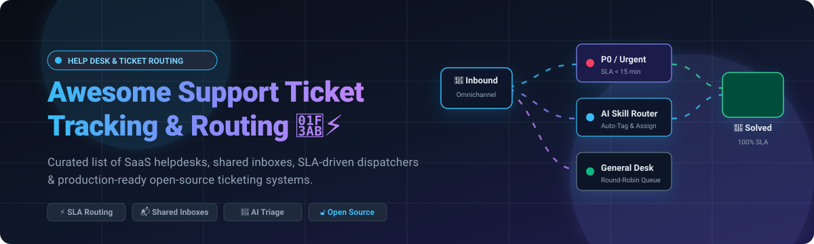

# Awesome Support Ticket Tracking & Routing 🎫⚡

  

  
  
  
  
  
  

> 🌟 A curated directory of premier **Support Ticket Tracking, SLA Routing Engines, Shared Inboxes, Customer Service Desks, and Self-Hosted Open-Source Help Desks**. Discover leading SaaS solutions and self-hosted alternatives to streamline agent dispatching, eliminate ticket backlog, and elevate customer experience.

---

## 📑 Table of Contents

- [📊 Sector Overview & Market Dynamics](#-sector-overview--market-dynamics)
- [☁️ SaaS/Hosted Platforms](#️-saashosted-platforms)
- [💻 Open-Source GitHub Projects](#-open-source-github-projects)
- [🤝 How to Contribute](#-how-to-contribute)
- [⭐ Star History](#-star-history)
- [💖 Support](#-support)
- [⚠️ Disclaimer](#️-disclaimer)

---

## 📊 Sector Overview & Market Dynamics

The global customer support, help desk, and ticketing software market is valued at approximately **$12.5 billion to $15 billion in 2025–2026**, expanding at a 10–12% CAGR driven by omnichannel service expectations, automated AI triage, and conversational customer support. The sector is **moderately fragmented**: mega-cap leaders such as Atlassian (Jira Service Management) and enterprise mainstays like Zendesk and HubSpot hold strong market shares across enterprise and mid-market accounts, while agile, specialized platforms (Gorgias in ecommerce, Help Scout in shared inboxes, Freshdesk and Zoho Desk in value-focused SMB) continuously capture significant segments with tailored workflows.

---

## ☁️ SaaS/Hosted Platforms

The table below benchmarks category-leading customer support and ticket routing platforms, sorted descending by company scale (market capitalization or latest enterprise valuation).

| 🏢 Platform | 💰 Scale (Valuation / Revenue) | 🏷️ Starting Tier Pricing | 🎁 Free Tier Limits | 📝 Description & Key Capabilities |
| :--- | :--- | :--- | :--- | :--- |
| **[HubSpot Ticket Management](https://www.hubspot.com/)** | ~$28 Billion (Public: HUBS) | $20/month per seat (Service Hub Starter, billed monthly) or $15/seat billed annually | **Free Forever**: Up to 5 users, includes shared inbox, closed ticket reporting, email ticketing, and ticketing forms. | Omnichannel ticketing embedded within HubSpot CRM; binds support tickets directly to CRM deals, contacts, and automation workflows with customer portal integration. |
| **[Jira Service Management](https://www.atlassian.com/software/jira/service-management)** | ~$45 Billion (Public: TEAM) | $22.05/agent per month (Standard, billed monthly) or $17.64/agent annually | **Free Forever**: Up to 3 agents, 2 GB file storage, unlimited customer request portals, community support, and standard ITSM request queues. | Enterprise-grade ITSM and ticketing framework; tightly integrates with Jira Software for issue tracking, release schedules, SLAs, and change-management workflows. |
| **[Zendesk](https://www.zendesk.com/)** | ~$10.2 Billion (Acquired by Hellman & Friedman) | $25/agent per month (Support Team, billed monthly) or $19/agent annually | **14-Day Free Trial**: Full access to omnichannel ticketing, business hours, and automated routing rules; no permanent free tier. | The industry standard for enterprise cloud help desks; rich omnichannel routing, macros, SLA policies, custom workflows, and an ecosystem of 1,200+ marketplace integrations. |
| **[Freshdesk](https://www.freshworks.com/freshdesk/)** | ~$4.5 Billion (Public: FRSH) | $18/agent per month (Growth, billed monthly) or $15/agent annually | **Free Forever**: Up to 2 agents, includes email/social ticketing, ticket dispatch, knowledge base, and team collaboration capabilities. | Modern, versatile customer support desk featuring automated skill-based routing, collision detection, customizable SLAs, and multi-channel customer ticketing. |
| **[Zoho Desk](https://www.zoho.com/desk/)** | ~$1.4 Billion Revenue (Zoho Corp Private) | $20/agent per month (Standard, billed monthly) or $14/agent annually | **Free Forever**: Up to 3 agents, email ticketing, customer management, private knowledge base, and basic SLAs. | Context-aware customer service platform with multi-department ticket routing, round-robin assignment, agent productivity dashboards, and native Zoho ecosystem integration. |
| **[Gorgias](https://www.gorgias.com/)** | ~$710 Million Valuation (Series C) | $10/month (Starter tier, billed monthly, includes 50 tickets/month + 3 seats) | **7-Day Free Trial**: Full feature access across Shopify/e-commerce integrations and automations; no permanent free tier. | E-commerce-specialized help desk (Shopify Premier Partner); merges email, live chat, and social direct messages into one inbox with immediate customer order editing capabilities. |
| **[Help Scout](https://www.helpscout.com/)** | ~$50 Million ARR (Private) | $25/user per month (Standard, billed monthly) or $22/user annually | **15-Day Free Trial**: Full access to 2 shared mailboxes, live chat, Docs knowledge base, and workflows; no permanent free tier. | Human-centric shared inbox and ticketing platform; provides clean email collaboration, proactive messaging, internal collision detection, and customer self-service docs. |
| **[HappyFox](https://www.happyfox.com/)** | ~$15 Million ARR (Private) | $39/agent per month (Mighty tier, billed monthly) or $29/agent annually (5 agent minimum) | **14-Day Free Trial**: Full access to automated smart routing, SLA management, and multilingual ticketing; no permanent free tier. | Practical mid-market help desk software with automated ticket scheduling, SLA escalation alerts, customizable ticket queues, and knowledge base portals. |
| **[TeamSupport](https://www.teamsupport.com/)** | ~$12 Million ARR (Private) | $49/agent per month (Essential Support, billed annually) | **14-Day Free Trial**: Full enterprise B2B ticketing features, company-level reporting, and customer distress indices; no permanent free tier. | B2B-focused customer service platform emphasizing business-level tracking, product defect reporting, and multi-tier customer relationship management. |
| **[Mojo Helpdesk](https://www.mojohelpdesk.com/)** | ~$5 Million ARR (Private) | $14/agent per month (Professional, billed monthly) or $11/agent annually | **30-Day Free Trial**: Complete access to unlimited ticket queues, Google Workspace integration, and auto-responders; no permanent free tier. | Lightweight, straightforward service desk optimized for education, internal IT, and agile teams requiring ticket routing and queue distribution without enterprise overhead. |

---

## 💻 Open-Source GitHub Projects

Curated list of self-hosted, open-source ticket tracking systems, shared inboxes, and ITSM service desks. Ranked descending by **GitHub Stargazers Count** ⭐.

| 📦 Repository & Project | ⭐ Stars | 📜 License | 🛠️ Tech Stack | 🎯 Target & Core Capabilities |
| :--- | :--- | :--- | :--- | :--- |
| **[Chatwoot](https://github.com/chatwoot/chatwoot)** |  | AGPL-3.0 | Ruby on Rails / Vue.js | Leading open-source omnichannel customer engagement suite; unifies live chat, email, WhatsApp, Twitter/X, Facebook, and Instagram with conversation assignment rules and bot webhooks. |
| **[UVdesk](https://github.com/uvdesk/community-skeleton)** |  | MIT | PHP / Symfony | Extensible, modular help desk system with mailbox piping, unlimited agents and teams, configurable ticket workflows, custom agent privileges, and front-office customer portals. |
| **[GLPI](https://github.com/glpi-project/glpi)** |  | GPL-3.0 | PHP / JavaScript | Comprehensive open-source IT asset management (ITAM) and issue tracking service desk; delivers ITIL-aligned service catalog, SLAs/OLAs, ticket lifecycle routing, and financial tracking. |
| **[Zammad](https://github.com/zammad/zammad)** |  | AGPL-3.0 | Ruby on Rails / Vue.js | Mature web-based customer support system; features full omnichannel integration (email, chat, phone, social), auto-assignment, multi-tier SLAs, collision detection, and LDAP/SSO sync. |
| **[FreeScout](https://github.com/freescout-help-desk/freescout)** |  | AGPL-3.0 | PHP / Laravel | Lightweight Zendesk and Help Scout alternative; offers zero-footprint email shared inbox, unlimited mailboxes and users, multi-channel modules (WhatsApp, Telegram, Slack), and push notifications. |
| **[osTicket](https://github.com/osTicket/osTicket)** |  | GPL-2.0 | PHP / MySQL | Widely deployed classic ticketing engine; converts email, phone, and web form requests into tickets with SLA plans, auto-responders, customer self-service portals, and staff department routing. |
| **[Chaskiq](https://github.com/chaskiq/chaskiq)** |  | AGPL-3.0 | Ruby on Rails / React | Conversational marketing and support platform alternative to Intercom and Drift; features real-time chat widgets, bot routing rules, mailing campaigns, and CRM integrations. |
| **[Frappe Helpdesk](https://github.com/frappe/helpdesk)** |  | AGPL-3.0 | Python / Frappe / Vue | Modern customer service software with native Frappe/ERPNext integration; includes interactive ticket dispatch, SLA timers, customer knowledge base, and agent assignment rules. |
| **[Peppermint](https://github.com/Peppermint-Lab/peppermint)** |  | AGPL-3.0 | Node.js / React / Express | Minimalist and fast open-source ticket management software; built for teams needing internal ticket queues, priority routing, tagging, and clean dashboard stats without bloat. |
| **[Libredesk](https://github.com/abhinavxd/libredesk)** |  | AGPL-3.0 | Go / Vue.js | High-performance customer support desk distributed as a single lightweight binary; features smart automation rules, multi-inbox management, macros, and SLA tracking. |
| **[MantisBT](https://github.com/mantisbt/mantisbt)** |  | GPL-2.0 | PHP / MariaDB | Battle-tested web-based bug and issue tracking system; supports project-based issue hierarchies, email notifications, role-based access controls, and audit trails. |
| **[Trudesk](https://github.com/polonel/trudesk)** |  | Apache-2.0 | Node.js / MongoDB | Clean, open-source help desk software built on Node.js and MongoDB; provides real-time ticket updates, priority management, agent assignment queues, and report generation. |
| **[Request Tracker (RT)](https://github.com/bestpractical/rt)** |  | GPL-2.0 | Perl / Relational DB | Industrial-strength ticketing engine used by Fortune 500s and academic institutions; features queue-level permissions, scrips automation, asset tracking, and audit-proof workflows. |
| **[ITFlow](https://github.com/itflow-org/itflow)** |  | GPL-3.0 | PHP / MySQL | Open-source IT documentation, ticketing, and client billing portal for MSPs and internal IT departments; provides ticket SLA tracking and client asset association. |
| **[Znuny](https://github.com/znuny/Znuny)** |  | AGPL-3.0 | Perl / JavaScript | Enterprise-grade service management platform (fork of OTRS); features multi-queue routing, approval workflows, custom state machines, and ITIL-aligned change tracking. |
| **[OTOBO](https://github.com/RotherOSS/otobo)** |  | GPL-3.0 | Perl / ElasticSearch | ITIL-compliant service desk and ITSM system based on OTRS; offers an upgraded responsive UI, customer portal, complex ticket routing, CMDB integration, and LDAP/RADIUS authentication. |

---

## 🤝 How to Contribute

1. 🍴 Fork this repository.
2. ✍️ Add or update entries in `README.md` following the established table structure and metadata conventions.
3. 🔗 Verify all links point directly to official documentation or source code repositories, and verify accurate pricing and licensing.
4. 🚀 Submit a Pull Request with a descriptive summary of your additions.

---

## ⭐ Star History

---

## 💖 Support

Thank you for exploring this curated repository! If you find this resource valuable for benchmarking or deploying customer support systems, please consider:

- ⭐ **Starring** the repository to support visibility.
- 🍴 **Forking** it to customize your team's internal evaluations.
- 📢 **Sharing** with support directors, IT administrators, and developer communities.
- ☕ **Sponsoring**: 

---

## ⚠️ Disclaimer

- This list is community-curated for informational and architectural evaluation purposes; inclusion does not constitute commercial endorsement.
- Verify software licensing terms before commercial self-hosting: several tools use copyleft licenses (AGPL-3.0, GPL-3.0), while others adopt permissive licenses (MIT, Apache-2.0).
- When self-hosting organizational help desks, maintain rigorous email deliverability configurations (SPF, DKIM, DMARC), automated database backups, SSO/MFA policies, and data retention configurations to safeguard customer data and comply with privacy frameworks (GDPR, CCPA).

---

**Built with ❤️ for support managers, IT administrators, and DevOps engineers architecting responsive customer service pipelines.**
